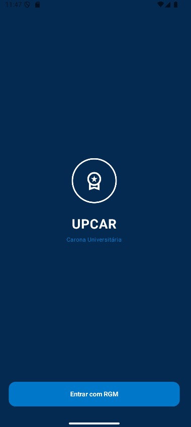
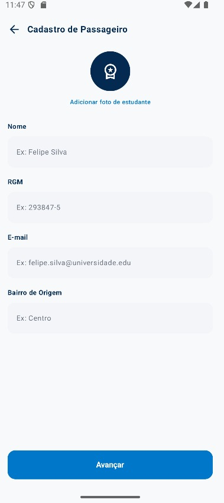
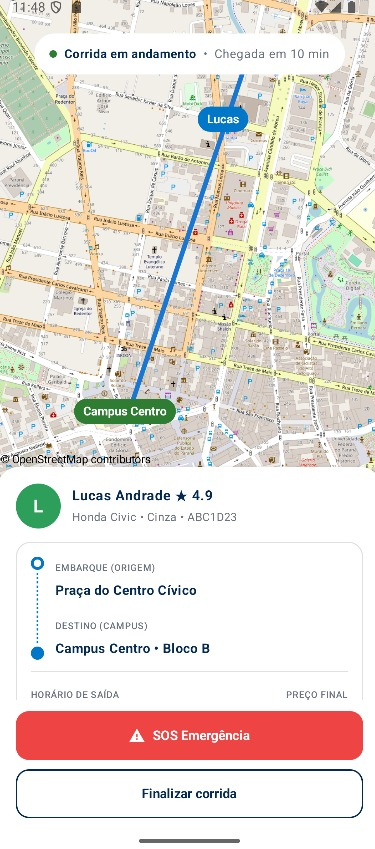
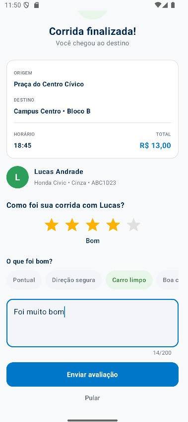
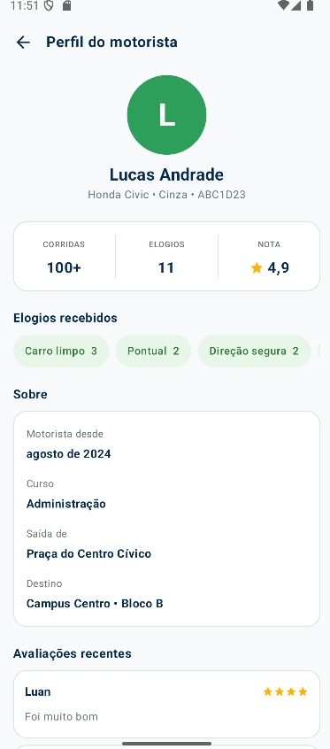

# UpCar

O **UpCar** é um aplicativo Android desenvolvido em Kotlin que simula a experiência de solicitar e acompanhar uma carona até um campus universitário. O projeto reúne cadastro de passageiro, consulta de motoristas, solicitação de carona, negociação simulada, acompanhamento da corrida e avaliação.

## Telas do aplicativo

### 1. Tela inicial

A tela de boas-vindas apresenta a identidade visual do UpCar e permite iniciar o fluxo de cadastro do passageiro.



### 2. Cadastro de passageiro

O passageiro informa nome, RGM, e-mail e bairro de origem antes de avançar no aplicativo.



### 3. Corrida em andamento

Durante a corrida, o aplicativo exibe um mapa, os dados do motorista, origem, destino e opções para finalizar a corrida ou acionar a opção de emergência. O progresso apresentado é simulado.



### 4. Corrida finalizada e avaliação

Ao chegar ao destino, o passageiro visualiza o resumo da corrida e pode atribuir uma nota, selecionar elogios e escrever um comentário.



### 5. Perfil do motorista

O perfil apresenta informações do motorista, estatísticas, elogios e avaliações. Parte dos dados exibidos no perfil é ilustrativa, conforme a implementação atual do projeto.



## Funcionalidades

- **Cadastro de passageiro:** registro de informações pessoais e bairro de origem.
- **Lista de motoristas:** visualização de opções com veículo, placa, horário, preço e avaliação.
- **Solicitação de carona:** criação de uma solicitação associada ao motorista escolhido.
- **Chat e negociação:** envio de mensagens, contraproposta e confirmação simulada de valor.
- **Mapas:** visualização de motoristas e acompanhamento visual da corrida.
- **Acompanhamento da corrida:** progresso simulado até a finalização.
- **Perfil do motorista:** consulta das informações e do histórico apresentado no aplicativo.
- **Avaliação:** atribuição de nota, comentário e elogios após a corrida.
- **Persistência local:** armazenamento de passageiros, motoristas, caronas, mensagens e avaliações usando Room.

> **Importante:** a negociação e o deslocamento são simulados. O projeto não representa um serviço de transporte conectado a motoristas reais nem oferece localização em tempo real. Algumas informações do perfil do motorista são ilustrativas.

## Como funciona

1. **Boas-vindas:** o usuário inicia o fluxo no aplicativo.
2. **Cadastro:** informa os dados do passageiro.
3. **Escolha do motorista:** consulta a lista e seleciona uma opção de carona.
4. **Solicitação e chat:** a carona é criada e uma conversa é associada a ela. O passageiro pode enviar mensagens e sugerir outro valor.
5. **Confirmação:** a negociação é simulada e o passageiro pode confirmar a carona.
6. **Corrida em andamento:** o aplicativo mostra o mapa e simula o progresso da viagem.
7. **Finalização e avaliação:** o passageiro conclui o fluxo e pode avaliar a experiência.

## Tecnologias utilizadas

- **Kotlin** — linguagem principal.
- **Android SDK** — plataforma do aplicativo.
- **Jetpack Compose e Material 3** — construção da interface.
- **Navigation Compose** — navegação entre telas.
- **ViewModel e Coroutines** — gerenciamento de estado e operações assíncronas.
- **Room** — persistência local sobre SQLite.
- **OSMDroid** — componentes de mapa.
- **Gradle Kotlin DSL** — configuração e compilação do projeto.

## Estrutura do projeto

Os principais arquivos estão em `app/src/main/java/com/example/upcar/`:

| Arquivo | Responsabilidade |
| --- | --- |
| `MainActivity.kt` | Ponto de entrada da interface Android. |
| `AppNavigation.kt` | Rotas e fluxo de navegação. |
| `BoasVindas.kt` | Tela inicial. |
| `CadastroPassageiro.kt` | Cadastro do passageiro. |
| `ProcuraMotorista.kt` | Listagem e seleção de motoristas. |
| `PerfilMotorista.kt` | Tela de perfil do motorista. |
| `Chat.kt` | Mensagens e negociação simulada. |
| `CorridaEmAndamento.kt` | Acompanhamento da corrida. |
| `CorridaFinalizada.kt` | Resumo e avaliação da corrida. |
| `MapaMotoristas.kt` e `MapaCorrida.kt` | Componentes de mapa. |
| `CaronaViewModel.kt` | Estado e coordenação das operações do aplicativo. |
| `Modelos.kt` | Entidades e modelos de dados. |
| `AppDatabase.kt` | Banco Room, DAOs e conversores. |
| `Validacoes.kt` e `Formatadores.kt` | Funções auxiliares. |

## Como executar

### Pré-requisitos

- Android Studio compatível com a configuração do projeto.
- JDK compatível com a versão do Android Gradle Plugin.
- Android SDK exigido pelo projeto.
- Emulador Android ou dispositivo físico.

### Passos

1. Clone o repositório:

   ```bash
   git clone https://github.com/LuanNeuwirthC/upcar3.git
   ```

2. Acesse a pasta do projeto:

   ```bash
   cd upcar3
   ```

3. Abra o projeto no Android Studio e aguarde a sincronização do Gradle.
4. Instale as versões do Android SDK solicitadas, caso necessário.
5. Selecione um emulador ou dispositivo Android e execute a configuração `app`.

Para compilar pelo terminal no Windows:

```powershell
.\gradlew.bat assembleDebug
```

No Linux ou macOS:

```bash
./gradlew assembleDebug
```

## Armazenamento de dados

O Room mantém dados localmente no dispositivo. As entidades persistidas incluem passageiros, motoristas, caronas, mensagens e avaliações. Os motoristas iniciais são inseridos quando o banco ainda não contém registros. Não foi identificado no fluxo analisado um backend remoto para sincronização entre dispositivos.

## Limitações atuais

- A negociação com o motorista é simulada.
- O progresso da corrida é simulado.
- Os dados são armazenados localmente, sem sincronização por servidor identificada.
- Algumas informações do perfil e avaliações demonstrativas são ilustrativas.
- A exibição de mapas depende da configuração de rede e dos serviços utilizados.

## Objetivo do projeto

O UpCar demonstra a construção de um fluxo de caronas em um aplicativo Android, combinando navegação entre telas, gerenciamento de estado, persistência local, mapas e interação simulada com o usuário.

---

Desenvolvido como projeto acadêmico.
